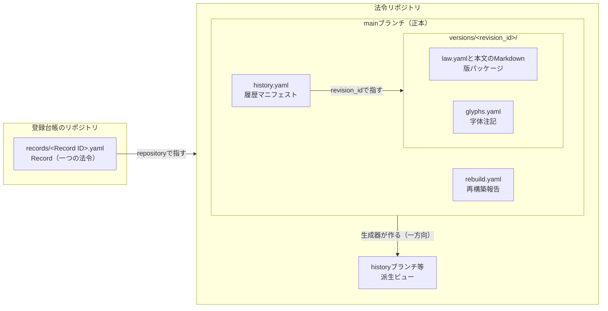
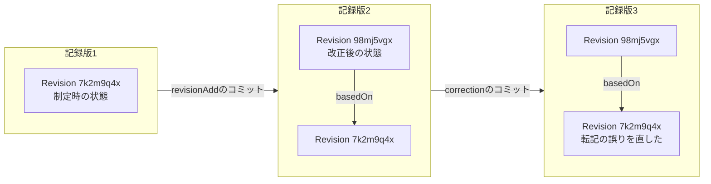

# Law of Japanプロジェクトに参加するために

このプロジェクトでは、その利便性を保つため、情報更新や追加にあたって様々なルールを設けています。この文書には、参加する前に読んでほしいことをまとめ、作業の各段階で確かめてほしい詳しい規則は、[作業ごとの文書](#作業ごとの文書)に分けています。
ここに記述されたルールは、作業ごとの文書を含め、プロジェクト内の法令文書を管理するすべてのリポジトリについて有効です。

## 規範仕様との関係

法令リポジトリのデータの形式は、[LoJ規範仕様](https://github.com/law-of-japan/loj-spec/blob/main/spec/README.md)（以下「仕様」）で定めます。このガイドラインは、仕様に従って法令リポジトリを運用するための手順と約束を定めるものです。本文中の`RID-03`等は、仕様の要件IDです。

- このガイドラインと仕様が食い違う場合は、仕様に従ってください。食い違いを見つけた場合は、このガイドラインの誤りとして報告してください。
- 対象とする仕様の版は、次の組です（仕様の「組み合わせて使える版」の組1）。

  | ファイル | schemaVersion |
  |---|---|
  | 版パッケージ（`law.yaml`と本文のMarkdown） | `loj/v1alpha2` |
  | 履歴マニフェスト（`history.yaml`） | `loj-history/v1alpha1` |
  | 字体注記（`glyphs.yaml`） | `loj-glyphs/v1alpha1` |
  | 再構築報告（`rebuild.yaml`） | `loj-rebuild/v1alpha1` |
  | 登録台帳のRecord（`records/<Record ID>.yaml`） | `loj-registry/v1alpha1` |

- `loj/v1alpha1`は凍結した版です。新しいデータを`loj/v1alpha1`で書かないでください。
- 従来の形式（このガイドラインの以前の版に従ったもの）の既存の法令リポジトリは、原典から作り直して新しい形式へ移します。手順は[従来の形式の既存のリポジトリを移すとき](docs/migrating-legacy-repositories.md)を参照してください。ただし、既存の法令リポジトリの移行は、仕様の検査器ができてから始めます。検査器がないと、移したデータが仕様に適合することを確かめられないためです。

## データの全体像

このプロジェクトで使う主な言葉の関係を、図で示します。図は仕様の要約です。仕様と食い違う場合は仕様に従ってください（定めは[CORE-01](https://github.com/law-of-japan/loj-spec/blob/main/spec/common/v1alpha1/01-overview.md#core-01-データの構成)、[CORE-02](https://github.com/law-of-japan/loj-spec/blob/main/spec/common/v1alpha1/01-overview.md#core-02-ファイルの種類とschemaversion)等）。言葉の意味は、仕様の[用語集](https://github.com/law-of-japan/loj-spec/blob/main/docs/glossary.md)で引けます。

### リポジトリとファイル

- 一つの法令を、登録台帳の一つのRecordで同定します。Recordは、Record IDで指します。題名や法令番号では指しません。
- 一つのRecordの履歴を、一つの法令リポジトリに置きます。法令の各時点の状態（Revision）は`history.yaml`に並べ、本文はRevisionごとの版パッケージ（`versions/<revision_id>/`）に置きます。
- 再構築報告（`rebuild.yaml`）は、従来の形式の既存のリポジトリから移したRecordにだけあります。
- 正本はmainブランチのデータです。`history`ブランチ等の派生ビューは正本から生成器が作るもので、人が編集せず、判断の根拠にもしません（[`history`ブランチ（派生ビュー）](docs/committing-and-merging.md#historyブランチ派生ビュー)）。

### 版と記録版

「版」に当たる言葉は三つあり、それぞれ別のものです。

図の横の並びはmainブランチのコミットの順で、枠の一つ一つが、そのコミットの時点の記録版です。

- **版**（Revision）は、法令の一つの状態です。改正があると、新しいRevisionを`revisionAdd`で加えます。Revisionの順は、施行日ではなく`basedOn`（直前の状態）で表します。どの改正で成立したかは、`history.yaml`の関係（`relations`）を`basis`で指して記録します。
- **記録版**は、mainブランチのあるコミットの時点での記録の内容です。転記の誤りの訂正（`correction`）や官報正誤（`officialCorrection`）は、Revisionを増やさずに記録版を更新します。mainブランチのGitの履歴は記録の変更の履歴であり、法令の改正の履歴ではありません（[コミットポリシー](docs/committing-and-merging.md#コミットポリシー)）。
- **仕様の版**は、ファイルの形式の版（`schemaVersion`。`loj/v1alpha2`等）です。法令の状態とは関係がありません。

## 文字保存方針

2026年11月7日決定。基礎データは原典の文字情報を保存する正本とし、固有名詞に限らず法令本文全体に適用します。

- 原典に対応するUnicode文字を選択し、コードポイント列をUTF-8で保存します。異なるコードポイントの文字は原則として区別し、LoJ独自の文字同一性体系は設けません。
- 國／国、學／学、體／体、髙／高、神／神を相互に置換しません。NFC・NFD・NFKC・NFKDを自動適用せず、正規等価・互換等価な文字列も選択したコードポイント列を保持します。
- 原典に対応する表現として記録された異体字セレクタとIVSを保持し、セレクタの自動追加・削除を行いません。IVSによる字形指定と文字同一性は区別します。
- 紙の原典にはコードポイントがないため、転記時に対応文字を選択します。同一コードポイントに統合された字形差、印刷書体、輪郭、フォント固有の字形、組版の完全再現は要求しません。必要な原典画像・書誌情報・異体字情報は別途管理します。
- Unicode表現を特定できない文字や判読困難な文字を、推測で別の文字に置換しません。記録・検証方法と曖昧な対応の判断基準は別途定めます。

新字体への統一、Unicode正規化、検索用の異体字統合、表示用の字体変換は独立した派生処理とし、基礎データを書き換えません。変換規則は必要に応じて独立して定義・バージョン管理し、基礎データから再生成できるようにします。

従来の方針で変換された既存データは、一括逆変換しません。原典の文字を一意に復元できない場合があるため、移行時には原典と再照合します。具体的な移行手順・適用範囲、IVSの詳細運用、原典との一致検証、派生処理の仕様・管理単位は未決定事項として別途定めます。既存の書式例は文字置換を認める根拠にはなりません。

上で「別途定めます」とした事項のうち仕様で定めたものと、本文を書くときの具体的な扱いは、[本文・データを書くとき](docs/writing-data.md#文字の扱い)にあります。

## 必ず守ること

作業を始める前に、次のことを必ず押さえてください。詳細は、それぞれのリンク先にあります。

- 本文は、公布された本文（官報と官報正誤）から起こします。官報を入手できない場合に限り、御署名原本を使います。e-Govの本文や従来の形式のリポジトリの本文は下書きにだけ使い、本文の根拠にはしません（[原典資料](docs/writing-data.md#原典資料)）。
- 本文の字を置き換えたり、正規化したりしません（[文字保存方針](#文字保存方針)）。
- Record IDとrevision_idは、ランダムに発行します。番号・日付・種別・題名や、施行日・改正法の番号から作ってはいけません（[リポジトリの名称](docs/creating-a-repository.md#リポジトリの名称)、[ファイル構成](docs/creating-a-repository.md#ファイル構成)）。
- mainブランチに直接コミットしてはいけません。mainブランチにforce pushしてもいけません（[ブランチの取り扱い](docs/committing-and-merging.md#ブランチの取り扱い)）。
- mainブランチの各コミットは、変更の種類を一つだけ宣言します（[変更の種類の宣言](docs/committing-and-merging.md#変更の種類の宣言)）。
- 従来の形式の既存のリポジトリの名称と旧履歴は、変えずに残します（[従来の形式の既存のリポジトリを移すとき](docs/migrating-legacy-repositories.md)）。

## 作業ごとの文書

作業の段階ごとに、次の文書を確かめてください。

| 文書 | 読む時点 |
|---|---|
| [法令リポジトリを作るとき](docs/creating-a-repository.md) | 新しい法令を登録し、法令リポジトリを作るとき。リポジトリの名称、作成の手順、ファイル構成 |
| [本文・データを書くとき](docs/writing-data.md) | 本文、`law.yaml`、`history.yaml`、`glyphs.yaml`等を書くとき。書式、原典資料、文字の扱い、未施行の法令、参照の書き方 |
| [コミットし、マージするとき](docs/committing-and-merging.md) | 作業ブランチを切り、コミットし、PRをマージするとき。ブランチ、変更の種類の宣言、コミットメッセージ、法令番号の表記 |
| [従来の形式の既存のリポジトリを移すとき](docs/migrating-legacy-repositories.md) | このガイドラインの以前の版に従った既存のリポジトリを、新しい形式へ移すとき |

## このガイドラインについて

このガイドラインはまだ完全ではなく、適宜修正、更新、追加される可能性がありますので、定期的に確認するようにしてください。
データの形式についての規範は[LoJ規範仕様](https://github.com/law-of-japan/loj-spec/blob/main/spec/README.md)です。仕様が改められた場合は、このガイドラインも合わせて改めます。

このガイドラインの文書は、読んでほしい時点で分けています。参加する前に読んでほしいことはこの文書に、作業中に確かめてほしいことは作業ごとの文書（`docs/`）に書きます。規則を足すときも、この分け方に従ってください。
